# Primeira entrega visual — Sentinel Consig 2.0

13/10/2026 · desenvolvimento · branch `codex/sentinel-2-visual-preview`.
Estado: pronta para revisão visual; migração completa NÃO iniciada. Nenhum push, merge ou deploy.

## Como avaliar

- Galeria local: http://127.0.0.1:5179/sentinel-2-preview.html
- Aplicação com backend/sessão de desenvolvimento: abrir a rota desejada com `?ui=2` (ex.: `/dashboard?ui=2`) ou “Avaliar Sentinel 2.0”.
- Interface antiga: botão “Prévia 2.0 · voltar à interface atual”, ou `?ui=legacy`.
- O portal do parceiro continua separado; nenhum ajuste nos componentes de portal, sessão ou contratos.

A galeria usa os mesmos componentes de apresentação, mas não simula login e não consulta a carteira. Seus indicadores estão vazios/indisponíveis. “Mostrar exemplos visuais” introduz apenas duas linhas de apresentação, sem CPF/valores reais nem cadastro persistido. Na aplicação autenticada, PreviewData lê StorageService e o serviço analytics existente, respeitando permissão e escopo; não utiliza essas fixtures.

## Mudanças estruturais

1. Uma sidebar única: oito grupos aprovados, links reais, expandida/compacta, grupos recolhíveis, busca de páginas, ícones coloridos e tooltips.
2. Topbar reaproveita os handlers do Header: busca, empresa explícita, notificações, tema, serviços e usuário. Remove a segunda seleção de empresa do menu no modo 2.0.
3. Dashboard com centro de trabalho antes do gráfico, prioridades/atalhos na coluna direita e indicadores reais da carteira disponível. Command Center de incidentes permanece separado.
4. Consulta de propostas com tabela compacta, pesquisa, banco/status, ordenação por data, paginação e abertura do detalhe existente. A tela completa permanece acessível e mantém campos, seleção, importação/exportação e demais ações.
5. Tokens claro/escuro, controles, estados vazios e paleta, foco visível e composição responsiva. CSS com escopo s2-root preserva o visual antigo e o portal.
6. Sidebar móvel fora da árvore acessível quando fechada; foco contido e Escape com retorno ao acionador quando aberta.
7. Preferências/dados de busca por escopo; recentes/favoritos rechecados contra acesso atual. Nenhum cache de CPF foi criado pela prévia.

## Fontes de indicadores

| Indicador | Fonte e conceito |
|---|---|
| Em andamento | StorageService.getProposals + isProposalOperationalActive, mesma seleção operacional do ControlTower |
| Volume liberado · pagas | Soma de disbursedValue de propostas cujo status existente é PAGO, mesma base do ControlTower |
| Fora do SLA/próximas do limite | AnalyticsApiService.fetchBottlenecks, incluindo fallback existente; nenhuma simplificação de calendário |
| Pendências em propostas | Status padrão PENDENTE/código PENDENTE nas propostas ativas; não é total da entidade pendência |
| Produção diária | createdAt na carteira disponível, agrupado por data America/Bahia; período aplicado ao gráfico |
| Carteira por banco | Propostas ativas no conjunto disponível; não é comissão nem receita financeira |

Nenhuma regra financeira, autenticação, servidor, API bancária, schema ou migration foi editada.

## Arquivos alterados/criados

### Código de frontend

- src/App.tsx — opt-in DEV, alternância antiga/nova, composição e preservação de handlers/modais.
- src/components/layout/Header.tsx — variante de apresentação e seletor visível, mesmos endpoints existentes.
- src/components/redesign/navigation.ts — agrupamento do catálogo, permissão e ordem visual.
- src/components/redesign/PreviewSidebar.tsx — navegação única e comportamento responsivo.
- src/components/redesign/PreviewDashboard.tsx — apresentação dos indicadores/fila/prioridades.
- src/components/redesign/PreviewProposals.tsx — consulta compacta e ponte para a lista completa.
- src/components/redesign/PreviewSearch.tsx — paleta com fontes carregadas/autorizadas.
- src/components/redesign/PreviewData.ts — adaptador de leitura de fontes existentes, com escopo e descarte de respostas tardias.
- src/styles/sentinel-2-preview.css — tokens e composição isolada da prévia.
- src/sentinel-2-preview.tsx e sentinel-2-preview.html — galeria local, somente DEV.
- tests/ui_redesign_preview.test.tsx — regressões puras sem banco/API.

### Documentação

- functional-inventory.md e redesign-plan.md — auditoria anterior agora incluída na branch.
- navigation-equivalence.md — caminhos e destinos antigos/novos.
- first-visual-delivery.md e validation-results.md — entrega, limites e execução.
- screenshots/*.jpg — provas de apresentação; sem dados de clientes.

## Capturas

Dashboard:

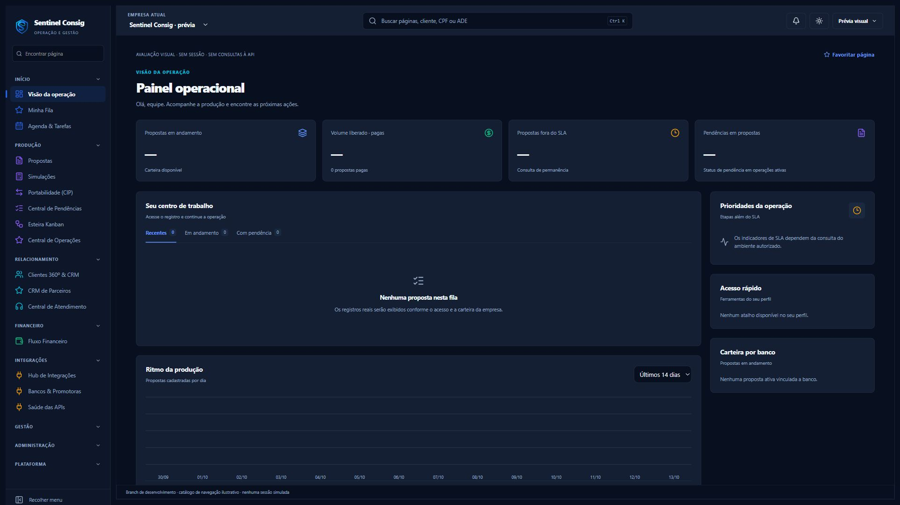
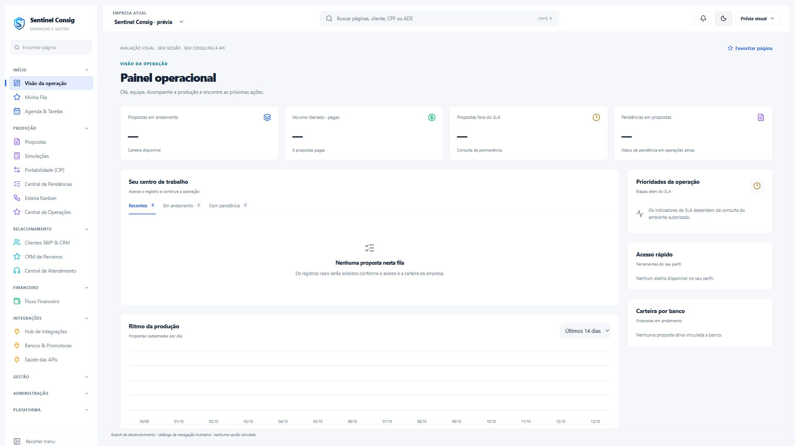
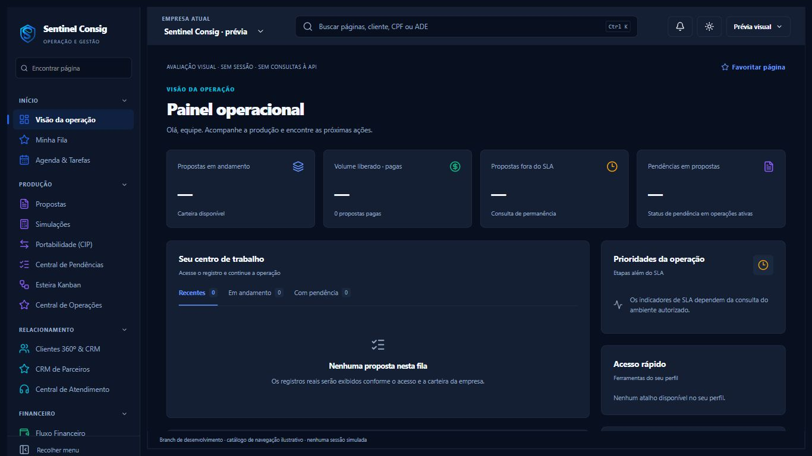
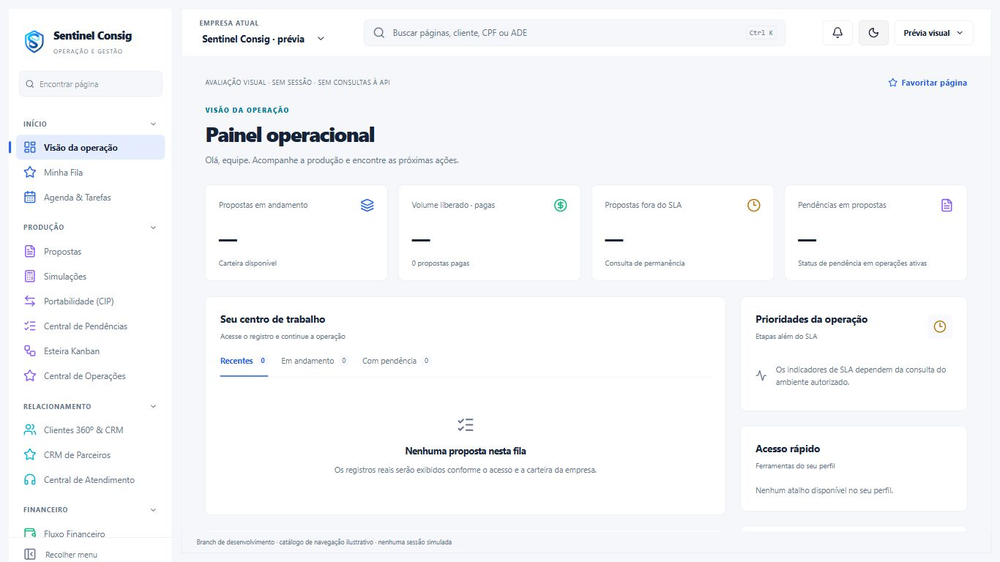

Tabela e navegação:

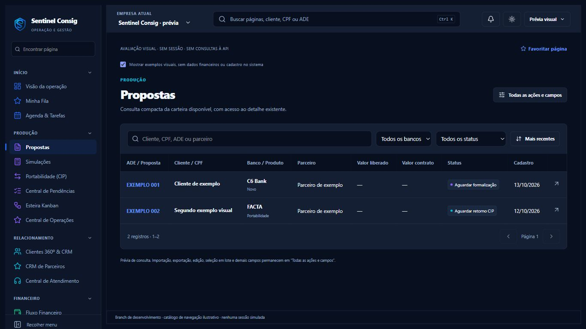
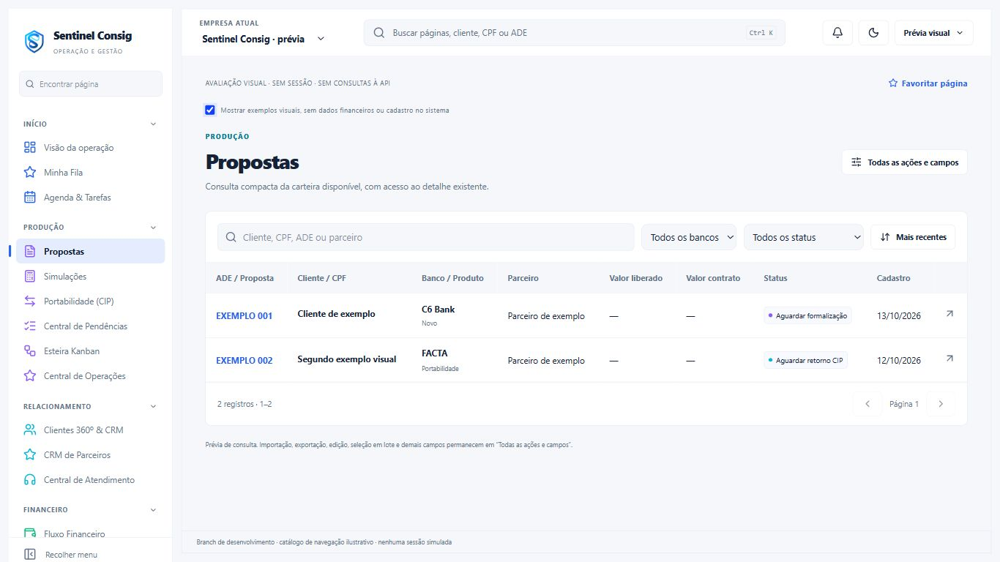
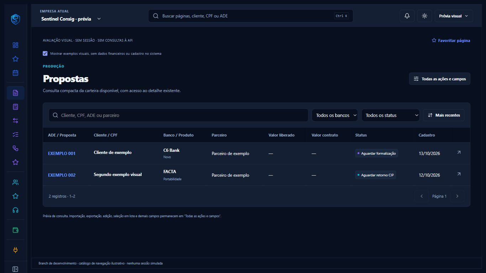
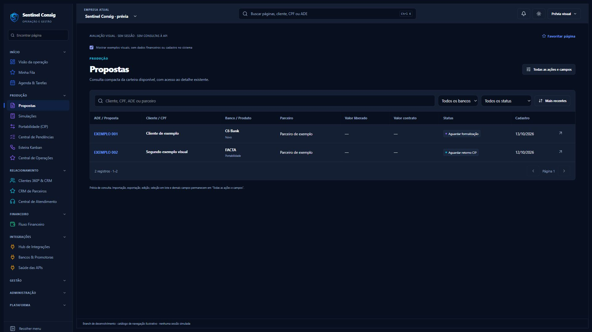
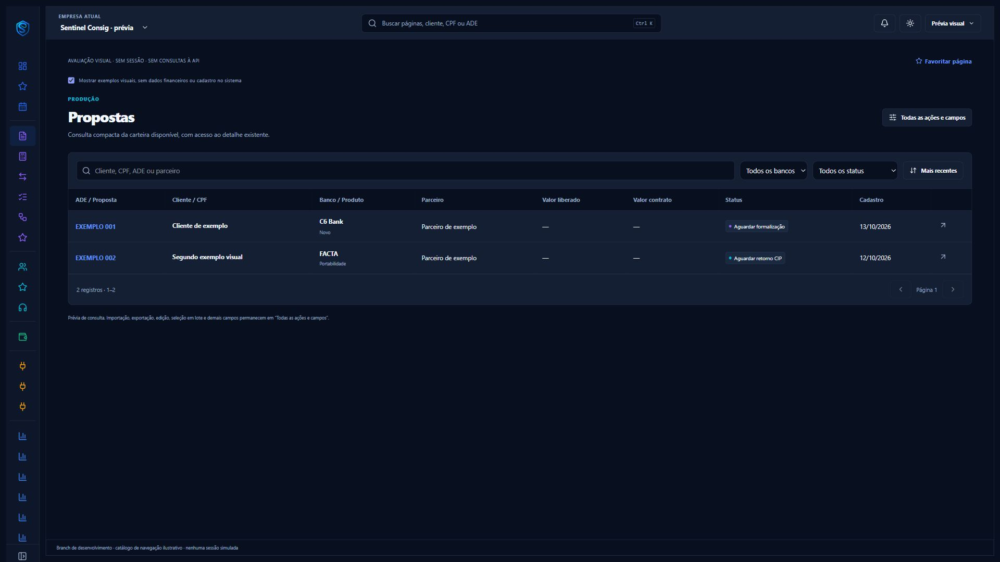
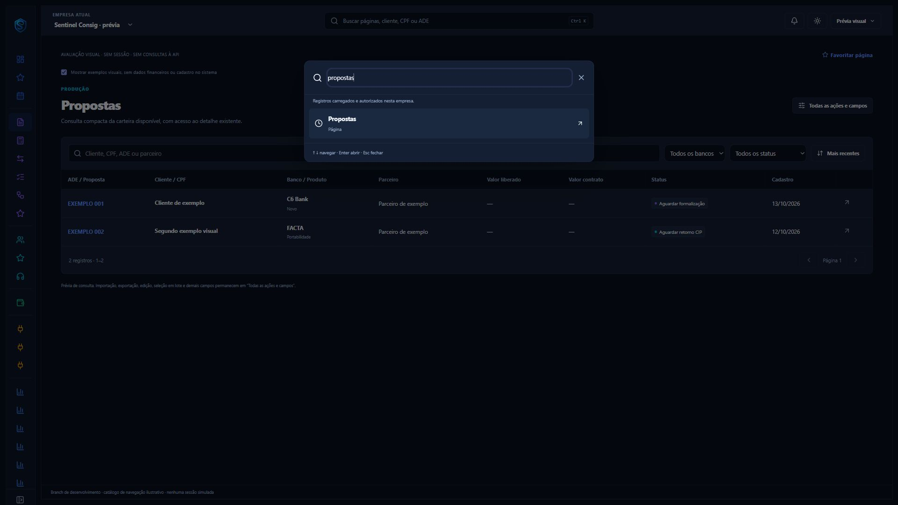

Responsividade adicional:

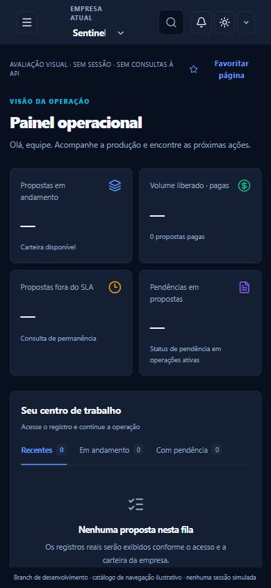
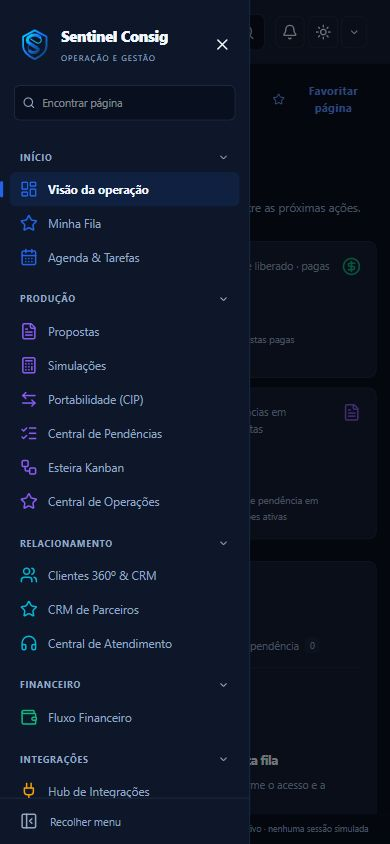

## Pendências e limites

- Validar com sessão de desenvolvimento, duas empresas e dados autorizados: troca real de empresa, membership, permissões por ação, branding customizado, realtime e abertura/CRUD dos modais.
- Backend no endpoint Vite desta galeria não fornece APIs autenticadas; abrir /login antes da galeria produziu avisos de respostas HTML em chamadas de negócio. A galeria limpa não os reproduz. Não iniciar servidor com base de produção apenas para obter capturas.
- Migração completa de produção/simulações/CIP/pendências/CRM/financeiro/admin não autorizada e não iniciada. As telas funcionais continuam sendo as atuais.
- Temas revisados nos novos componentes. Modais e módulos legados ainda exigem revisão visual autenticada; não declarar todos os módulos modernizados.
- Favoritos e densidade usam as preferências existentes por usuário/tenant; disponíveis na topbar e no menu de usuário. A galeria utiliza apenas um exemplo local de favorito.
- Busca utiliza o conjunto carregado, não índice remoto completo. Os campos pessoais não são guardados como histórico pela paleta.
- Não há confirmação de preservação integral por build/typecheck; consultar resultados e bloqueios na matriz de testes.

## Ponto de parada

Aguardar aprovação visual desta primeira composição. Nenhuma migração de módulo nem publicação é autorizada pelo estágio atual.
